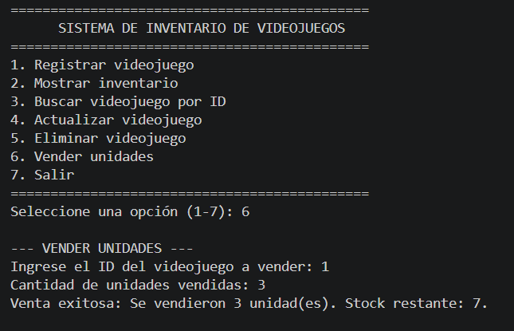
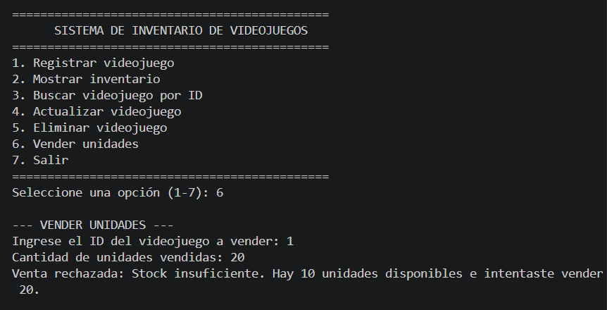

# Sistema de Gestión de Inventario de Videojuegos

## 1. Propósito del Sistema
Esta aplicación de consola desarrollada en Python permite gestionar el inventario de una tienda de videojuegos aplicando operaciones CRUD completas (Crear, Leer, Actualizar, Eliminar) y control de ventas. La persistencia de los datos se realiza mediante SQLite y se implementa una arquitectura por capas basada en el patrón DAO (Data Access Object) para garantizar la separación de responsabilidades.

---

## 2. Estructura del Proyecto
El sistema se organiza en los siguientes módulos:

* *modelo.py*: Define la clase Producto, representando la entidad del inventario con sus atributos básicos (id, nombre, precio y stock).
* *base_datos.py*: Administra la conexión con la base de datos SQLite (inventario_videojuegos.db) y se encarga de crear la tabla productos si no existe.
* *producto_dao.py*: Objeto de Acceso a Datos (DAO). Es el único componente que interactúa directamente con la base de datos mediante sentencias SQL parametrizadas (INSERT, SELECT, UPDATE, DELETE).
* *producto_servicio.py*: Capa de lógica del negocio. Contiene las validaciones (precios positivos, stock no negativo, campos obligatorios, control de stock en ventas) antes de delegar la persistencia al DAO.
* *main.py*: Punto de entrada de la aplicación. Presenta el menú interactivo de consola y maneja excepciones para evitar cierres inesperados por entradas inválidas.

---

## 3. Funcionalidades Implementadas
1. *Registrar videojuego:* Solicita nombre, precio unitario y cantidad inicial en stock.
2. *Mostrar inventario:* Lista todos los videojuegos registrados en formato tabular con su ID, nombre, precio y existencias.
3. *Buscar videojuego:* Consulta los datos de un producto específico mediante su ID e informa si no existe.
4. *Actualizar videojuego:* Permite modificar el nombre, precio y stock de un producto existente.
5. *Eliminar videojuego:* Remueve un producto del inventario mediante su ID previa confirmación.
6. *Vender unidades:* Descuenta del inventario la cantidad solicitada si el stock es suficiente y rechaza ventas mayores a la existencia.
7. *Salir:* Finaliza la ejecución del programa de forma segura.

---

## 4. Validaciones del Sistema
* No se permiten nombres vacíos o compuestos únicamente por espacios.
* El precio debe ser un valor numérico estrictamente mayor a cero.
* El stock inicial y actualizado no puede ser negativo.
* En las ventas, la cantidad solicitada debe ser mayor a cero.
* Se rechazan ventas si la cantidad solicitada supera las existencias disponibles.
* Se notifica al usuario si el ID consultado, actualizado o eliminado no existe.
* Manejo de errores de entrada en consola (ValueError) para evitar que el programa se cierre por tipos de datos incorrectos.

---

## 5. Instrucciones de Ejecución

### Prerrequisitos
* Tener instalado Python 3.8 o superior.
* No se requieren dependencias externas (utiliza la librería nativa sqlite3).

### Pasos para ejecutar
1. Clonar el repositorio:
   bash
   git clone [https://github.com/saryduarte/inventario-videojuegos.git](https://github.com/saryduarte/inventario-videojuegos.git)
   cd inventario-videojuegos
   

2. Ejecutar la aplicación en la terminal:
   bash
   python main.py
   

---

## 6. Pruebas de Funcionamiento

| Caso de Prueba | Entrada | Resultado Esperado | Resultado Obtenido |
| :--- | :--- | :--- | :--- |
| *Registrar Resident Evil 4* | Precio: 180000, Stock: 10 | Producto guardado correctamente | Exitoso |
| *Mostrar inventario* | Opción 2 | Aparecen los productos registrados | Exitoso |
| *Buscar un ID existente* | ID: 1 | Se muestran los datos del producto | Exitoso |
| *Actualizar un producto* | ID: 1, nuevos valores | Los cambios quedan guardados en SQLite | Exitoso |
| *Vender unidades (Éxito)* | ID: 1, Cantidad: 3 | El stock pasa de 10 a 7 | Exitoso |
| *Vender unidades (Rechazo)* | ID: 1, Cantidad: 20 | Se rechaza la operación y se conserva el stock | Exitoso |
| *Buscar un ID inexistente* | ID: 999 | Se informa que no existe | Exitoso |
| *Eliminar un producto* | ID: 1 | El producto deja de aparecer en el inventario | Exitoso |

---

## 7. Evidencias de Ejecución

### Operación Exitosa (Registro y Venta)

### Operación Rechazada (Stock Insuficiente)

